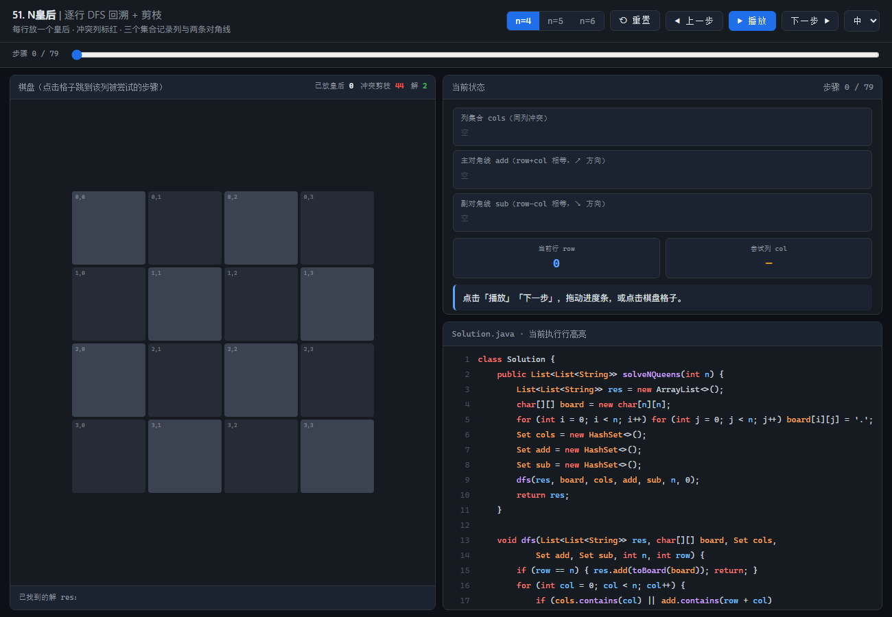
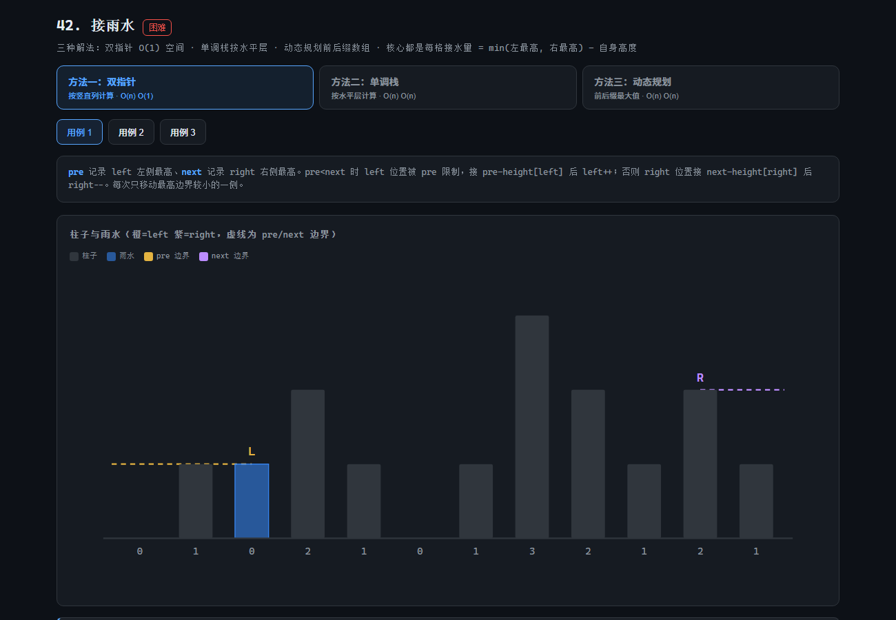
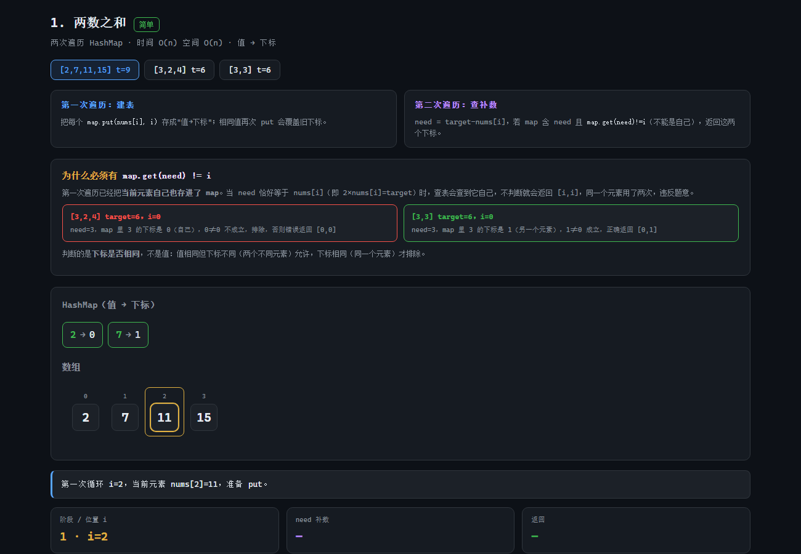

<div align="center">

# LeetCode 热题 100 · 可视化题解

**把抽象算法「看着跑」起来 —— 每题一篇可交互 HTML 图解，看见每一步，而不是背下每一行**

[](https://github.com/kaiyuzhao116/leetcode-hot100-visual/stargazers)
[](https://github.com/kaiyuzhao116/leetcode-hot100-visual/forks)
[](https://github.com/kaiyuzhao116/leetcode-hot100-visual/commits/main)
[](https://github.com/kaiyuzhao116/leetcode-hot100-visual)
[](LICENSE)

[🌐 在线刷题](https://kaiyuzhao116.github.io/leetcode-hot100-visual/) &nbsp;·&nbsp; [📘 题目清单](#题目清单) &nbsp;·&nbsp; [🧩 进度看板](#进度看板) &nbsp;·&nbsp; [🚀 每日更新](#每天怎么更新)

</div>

---

## 这是什么

LeetCode「热题 100」是中文社区公认的算法入门主线，但大多数题解只有静态代码 + 几行注释：
**看完觉得懂了，合上就忘，面试一写就卡。**

这个仓库做的是另一件事 —— 把每道题的**执行过程**做成一篇可以自己操控的网页：

- 🎬 **每一步都看得见**：数组、哈希表、双指针、递归调用栈、BFS 队列、回溯搜索树……都在页面上真实动起来，支持暂停 / 单步 / 调速 / 拖进度条。
- 📦 **单文件、零依赖**：每篇题解就是一个 HTML 文件，不加载任何外部 CDN，双击即开，飞机上也能看。
- 🧭 **先讲为什么，再讲怎么写**：每页都有一节「为什么这么做 / 为什么不能那么做」，用反例把边界条件讲透。
- 🧱 **按专题推进，进度实时更新**：17 个专题逐个攻克，当前 **72 / 100**，未完成的题目按计划补齐。

> 不是把答案抄一遍，而是把「为什么这么想」拆成一步一动画出来。

---

## 先看一眼

<table>
<tr>
<td width="50%"></td>
<td width="50%"></td>
</tr>
<tr>
<td></td>
<td></td>
</tr>
</table>

---

## 进度看板

**72 / 100 已完成** &nbsp;·&nbsp; **93 篇可视化图解** &nbsp;·&nbsp; 剩余待补：74、34、33、153、4、121、55、45、763、70、118、198、279、322、139、300、152、416、62、64、5、1143、72、136、169、75、31、287

| 专题 | 题数 | 已完成 | 进度 |
|:--|--:|--:|:--|
| **哈希** | 3 | 3 | ●●●●●●●●●● 100% |
| **双指针** | 4 | 4 | ●●●●●●●●●● 100% |
| **滑动窗口** | 2 | 2 | ●●●●●●●●●● 100% |
| **子串** | 3 | 3 | ●●●●●●●●●● 100% |
| **普通数组** | 5 | 5 | ●●●●●●●●●● 100% |
| **矩阵** | 4 | 4 | ●●●●●●●●●● 100% |
| **链表** | 14 | 14 | ●●●●●●●●●● 100% |
| **二叉树** | 15 | 15 | ●●●●●●●●●● 100% |
| **图论** | 4 | 4 | ●●●●●●●●●● 100% |
| **回溯** | 8 | 8 | ●●●●●●●●●● 100% |
| **二分查找** | 6 | 1 | ●○○○○○○○○○ 17% |
| **栈** | 5 | 5 | ●●●●●●●●●● 100% |
| **堆** | 3 | 3 | ●●●●●●●●●● 100% |
| **贪心算法** | 4 | 0 | ○○○○○○○○○○ 0% |
| **动态规划** | 10 | 1 | ●○○○○○○○○○ 10% |
| **多维动态规划** | 5 | 0 | ○○○○○○○○○○ 0% |
| **技巧** | 5 | 0 | ○○○○○○○○○○ 0% |

<details>
<summary>进度是怎么统计的</summary>

每个题号对应一个目录，目录下的 HTML 数量就是该题的图解篇数；有些题会保留「双指针版 / 单调栈版」等多篇对照。数据由 `tools/build.py` 扫描目录自动生成，不手工维护。

</details>

---

## 题目清单

<details open>
<summary><b>哈希</b> &nbsp;·&nbsp; 3/3</summary>

| # | 题目 | 难度 | 图解 |
|:--|:--|:--|:--|
| 1 | 两数之和 | 🟢 简单 | [查看 2 篇](1.%E4%B8%A4%E6%95%B0%E4%B9%8B%E5%92%8C/%E4%B8%A4%E6%95%B0%E4%B9%8B%E5%92%8C-%E5%93%88%E5%B8%8C%E8%A1%A8%E5%8F%AF%E8%A7%86%E5%8C%96.html) |
| 49 | 字母异位词分组 | 🟡 中等 | [查看图解](49.%E5%AD%97%E6%AF%8D%E5%BC%82%E4%BD%8D%E8%AF%8D%E5%88%86%E7%BB%84/%E5%AD%97%E6%AF%8D%E5%BC%82%E4%BD%8D%E8%AF%8D%E5%88%86%E7%BB%84-%E5%93%88%E5%B8%8C%E5%8F%AF%E8%A7%86%E5%8C%96.html) |
| 128 | 最长连续序列 | 🟡 中等 | [查看 2 篇](128.%E6%9C%80%E9%95%BF%E8%BF%9E%E7%BB%AD%E5%BA%8F%E5%88%97/%E6%9C%80%E9%95%BF%E8%BF%9E%E7%BB%AD%E5%BA%8F%E5%88%97-%E5%93%88%E5%B8%8C%E5%8F%AF%E8%A7%86%E5%8C%96.html) |

</details>

<details>
<summary><b>双指针</b> &nbsp;·&nbsp; 4/4</summary>

| # | 题目 | 难度 | 图解 |
|:--|:--|:--|:--|
| 283 | 移动零 | 🟢 简单 | [查看图解](283.%E7%A7%BB%E5%8A%A8%E9%9B%B6/%E7%A7%BB%E5%8A%A8%E9%9B%B6-%E5%8F%8C%E6%8C%87%E9%92%88%E5%8F%AF%E8%A7%86%E5%8C%96.html) |
| 11 | 盛最多水的容器 | 🟡 中等 | [查看图解](11.%E7%9B%9B%E6%9C%80%E5%A4%9A%E6%B0%B4%E7%9A%84%E5%AE%B9%E5%99%A8/%E7%9B%9B%E6%9C%80%E5%A4%9A%E6%B0%B4%E7%9A%84%E5%AE%B9%E5%99%A8-%E5%8F%8C%E6%8C%87%E9%92%88%E5%8F%AF%E8%A7%86%E5%8C%96.html) |
| 15 | 三数之和 | 🟡 中等 | [查看图解](15.%E4%B8%89%E6%95%B0%E4%B9%8B%E5%92%8C/%E4%B8%89%E6%95%B0%E4%B9%8B%E5%92%8C-%E5%8F%8C%E6%8C%87%E9%92%88%E5%8F%AF%E8%A7%86%E5%8C%96.html) |
| 42 | 接雨水 | 🔴 困难 | [查看 2 篇](42.%E6%8E%A5%E9%9B%A8%E6%B0%B4/%E6%8E%A5%E9%9B%A8%E6%B0%B4-%E5%8F%8C%E6%8C%87%E9%92%88%E5%8F%AF%E8%A7%86%E5%8C%96.html) |

</details>

<details>
<summary><b>滑动窗口</b> &nbsp;·&nbsp; 2/2</summary>

| # | 题目 | 难度 | 图解 |
|:--|:--|:--|:--|
| 3 | 无重复字符的最长子串 | 🟡 中等 | [查看图解](3.%E6%97%A0%E9%87%8D%E5%A4%8D%E5%AD%97%E7%AC%A6%E7%9A%84%E6%9C%80%E9%95%BF%E5%AD%90%E4%B8%B2/%E6%97%A0%E9%87%8D%E5%A4%8D%E5%AD%97%E7%AC%A6%E6%9C%80%E9%95%BF%E5%AD%90%E4%B8%B2-%E6%BB%91%E5%8A%A8%E7%AA%97%E5%8F%A3%E5%8F%AF%E8%A7%86%E5%8C%96.html) |
| 438 | 找到字符串中所有字母异位词 | 🟡 中等 | [查看图解](438.%E6%89%BE%E5%88%B0%E5%AD%97%E7%AC%A6%E4%B8%B2%E4%B8%AD%E6%89%80%E6%9C%89%E5%AD%97%E6%AF%8D%E5%BC%82%E4%BD%8D%E8%AF%8D/%E5%AD%97%E6%AF%8D%E5%BC%82%E4%BD%8D%E8%AF%8D-%E5%AE%9A%E9%95%BF%E6%BB%91%E5%8A%A8%E7%AA%97%E5%8F%A3%E5%8F%AF%E8%A7%86%E5%8C%96.html) |

</details>

<details>
<summary><b>子串</b> &nbsp;·&nbsp; 3/3</summary>

| # | 题目 | 难度 | 图解 |
|:--|:--|:--|:--|
| 560 | 和为 K 的子数组 | 🟡 中等 | [查看图解](560.%E5%92%8C%E4%B8%BAK%E7%9A%84%E5%AD%90%E6%95%B0%E7%BB%84/%E5%92%8C%E4%B8%BAK%E7%9A%84%E5%AD%90%E6%95%B0%E7%BB%84-%E5%89%8D%E7%BC%80%E5%92%8C%E5%93%88%E5%B8%8C%E5%8F%AF%E8%A7%86%E5%8C%96.html) |
| 239 | 滑动窗口最大值 | 🔴 困难 | [查看图解](239.%E6%BB%91%E5%8A%A8%E7%AA%97%E5%8F%A3%E6%9C%80%E5%A4%A7%E5%80%BC/%E6%BB%91%E5%8A%A8%E7%AA%97%E5%8F%A3%E6%9C%80%E5%A4%A7%E5%80%BC-%E5%8D%95%E8%B0%83%E9%98%9F%E5%88%97%E5%8F%AF%E8%A7%86%E5%8C%96.html) |
| 76 | 最小覆盖子串 | 🔴 困难 | [查看图解](76.%E6%9C%80%E5%B0%8F%E8%A6%86%E7%9B%96%E5%AD%90%E4%B8%B2/%E6%9C%80%E5%B0%8F%E8%A6%86%E7%9B%96%E5%AD%90%E4%B8%B2-%E6%BB%91%E5%8A%A8%E7%AA%97%E5%8F%A3%E5%8F%AF%E8%A7%86%E5%8C%96.html) |

</details>

<details>
<summary><b>普通数组</b> &nbsp;·&nbsp; 5/5</summary>

| # | 题目 | 难度 | 图解 |
|:--|:--|:--|:--|
| 53 | 最大子数组和 | 🟡 中等 | [查看图解](53.%E6%9C%80%E5%A4%A7%E5%AD%90%E6%95%B0%E7%BB%84%E5%92%8C/%E6%9C%80%E5%A4%A7%E5%AD%90%E6%95%B0%E7%BB%84%E5%92%8C-%E5%8A%A8%E6%80%81%E8%A7%84%E5%88%92%E5%8F%AF%E8%A7%86%E5%8C%96.html) |
| 56 | 合并区间 | 🟡 中等 | [查看图解](56.%E5%90%88%E5%B9%B6%E5%8C%BA%E9%97%B4/%E5%90%88%E5%B9%B6%E5%8C%BA%E9%97%B4-%E6%8E%92%E5%BA%8F%E5%8F%AF%E8%A7%86%E5%8C%96.html) |
| 189 | 轮转数组 | 🟡 中等 | [查看图解](189.%E8%BD%AE%E8%BD%AC%E6%95%B0%E7%BB%84/%E8%BD%AE%E8%BD%AC%E6%95%B0%E7%BB%84-%E4%B8%89%E6%AC%A1%E7%BF%BB%E8%BD%AC%E5%8F%AF%E8%A7%86%E5%8C%96.html) |
| 238 | 除自身以外数组的乘积 | 🟡 中等 | [查看图解](238.%E9%99%A4%E8%87%AA%E8%BA%AB%E4%BB%A5%E5%A4%96%E6%95%B0%E7%BB%84%E7%9A%84%E4%B9%98%E7%A7%AF/%E9%99%A4%E8%87%AA%E8%BA%AB%E4%BB%A5%E5%A4%96%E6%95%B0%E7%BB%84%E4%B9%98%E7%A7%AF-%E5%B7%A6%E5%8F%B3%E4%B9%98%E7%A7%AF%E5%8F%AF%E8%A7%86%E5%8C%96.html) |
| 41 | 缺失的第一个正数 | 🔴 困难 | [查看图解](41.%E7%BC%BA%E5%A4%B1%E7%9A%84%E7%AC%AC%E4%B8%80%E4%B8%AA%E6%AD%A3%E6%95%B0/%E7%BC%BA%E5%A4%B1%E7%AC%AC%E4%B8%80%E4%B8%AA%E6%AD%A3%E6%95%B0-HashSet%E5%8F%AF%E8%A7%86%E5%8C%96.html) |

</details>

<details>
<summary><b>矩阵</b> &nbsp;·&nbsp; 4/4</summary>

| # | 题目 | 难度 | 图解 |
|:--|:--|:--|:--|
| 73 | 矩阵置零 | 🟡 中等 | [查看图解](73.%E7%9F%A9%E9%98%B5%E7%BD%AE%E9%9B%B6/%E7%9F%A9%E9%98%B5%E7%BD%AE%E9%9B%B6-%E6%A0%87%E8%AE%B0%E6%95%B0%E7%BB%84%E5%8F%AF%E8%A7%86%E5%8C%96.html) |
| 54 | 螺旋矩阵 | 🟡 中等 | [查看图解](54.%E8%9E%BA%E6%97%8B%E7%9F%A9%E9%98%B5/%E8%9E%BA%E6%97%8B%E7%9F%A9%E9%98%B5-%E5%9B%9B%E8%BE%B9%E7%95%8C%E5%8F%AF%E8%A7%86%E5%8C%96.html) |
| 48 | 旋转图像 | 🟡 中等 | [查看图解](48.%E6%97%8B%E8%BD%AC%E5%9B%BE%E5%83%8F/%E6%97%8B%E8%BD%AC%E5%9B%BE%E5%83%8F-%E8%BD%AC%E7%BD%AE%E7%BF%BB%E8%BD%AC%E5%8F%AF%E8%A7%86%E5%8C%96.html) |
| 240 | 搜索二维矩阵 II | 🟡 中等 | [查看图解](240.%E6%90%9C%E7%B4%A2%E4%BA%8C%E7%BB%B4%E7%9F%A9%E9%98%B5II/%E6%90%9C%E7%B4%A2%E4%BA%8C%E7%BB%B4%E7%9F%A9%E9%98%B5-%E5%8F%B3%E4%B8%8A%E8%A7%92Z%E5%AD%97%E5%BD%A2%E5%8F%AF%E8%A7%86%E5%8C%96.html) |

</details>

<details>
<summary><b>链表</b> &nbsp;·&nbsp; 14/14</summary>

| # | 题目 | 难度 | 图解 |
|:--|:--|:--|:--|
| 160 | 相交链表 | 🟢 简单 | [查看图解](160.%E7%9B%B8%E4%BA%A4%E9%93%BE%E8%A1%A8/%E7%9B%B8%E4%BA%A4%E9%93%BE%E8%A1%A8-%E5%8F%8C%E6%8C%87%E9%92%88%E5%8F%AF%E8%A7%86%E5%8C%96.html) |
| 206 | 反转链表 | 🟢 简单 | [查看图解](206.%E5%8F%8D%E8%BD%AC%E9%93%BE%E8%A1%A8/%E5%8F%8D%E8%BD%AC%E9%93%BE%E8%A1%A8-%E5%A4%B4%E6%8F%92%E6%B3%95%E5%8F%AF%E8%A7%86%E5%8C%96.html) |
| 234 | 回文链表 | 🟢 简单 | [查看图解](234.%E5%9B%9E%E6%96%87%E9%93%BE%E8%A1%A8/%E5%9B%9E%E6%96%87%E9%93%BE%E8%A1%A8-%E4%B8%AD%E7%82%B9%E5%8F%8D%E8%BD%AC%E6%AF%94%E5%AF%B9%E5%8F%AF%E8%A7%86%E5%8C%96.html) |
| 141 | 环形链表 | 🟢 简单 | [查看图解](141.%E7%8E%AF%E5%BD%A2%E9%93%BE%E8%A1%A8/%E7%8E%AF%E5%BD%A2%E9%93%BE%E8%A1%A8-%E5%BF%AB%E6%85%A2%E6%8C%87%E9%92%88%E5%8F%AF%E8%A7%86%E5%8C%96.html) |
| 142 | 环形链表 II | 🟡 中等 | [查看图解](142.%E7%8E%AF%E5%BD%A2%E9%93%BE%E8%A1%A8%20II/%E7%8E%AF%E5%BD%A2%E9%93%BE%E8%A1%A8II-%E6%89%BE%E5%85%A5%E5%8F%A3%E5%8F%AF%E8%A7%86%E5%8C%96.html) |
| 21 | 合并两个有序链表 | 🟢 简单 | [查看图解](21.%E5%90%88%E5%B9%B6%E4%B8%A4%E4%B8%AA%E6%9C%89%E5%BA%8F%E9%93%BE%E8%A1%A8/%E5%90%88%E5%B9%B6%E4%B8%A4%E4%B8%AA%E6%9C%89%E5%BA%8F%E9%93%BE%E8%A1%A8-%E5%8F%8C%E6%8C%87%E9%92%88%E5%8F%AF%E8%A7%86%E5%8C%96.html) |
| 2 | 两数相加 | 🟡 中等 | [查看图解](2.%E4%B8%A4%E6%95%B0%E7%9B%B8%E5%8A%A0/%E4%B8%A4%E6%95%B0%E7%9B%B8%E5%8A%A0-%E8%BF%9B%E4%BD%8D%E6%A8%A1%E6%8B%9F%E5%8F%AF%E8%A7%86%E5%8C%96.html) |
| 19 | 删除链表的倒数第 N 个结点 | 🟡 中等 | [查看图解](19.%E5%88%A0%E9%99%A4%E9%93%BE%E8%A1%A8%E7%9A%84%E5%80%92%E6%95%B0%E7%AC%ACN%E4%B8%AA%E7%BB%93%E7%82%B9/%E5%88%A0%E9%99%A4%E5%80%92%E6%95%B0%E7%AC%ACN%E4%B8%AA%E8%8A%82%E7%82%B9-%E5%8F%8C%E6%8C%87%E9%92%88%E5%8F%AF%E8%A7%86%E5%8C%96.html) |
| 24 | 两两交换链表中的节点 | 🟡 中等 | [查看图解](24.%E4%B8%A4%E4%B8%A4%E4%BA%A4%E6%8D%A2%E9%93%BE%E8%A1%A8%E4%B8%AD%E7%9A%84%E8%8A%82%E7%82%B9/%E4%B8%A4%E4%B8%A4%E4%BA%A4%E6%8D%A2%E9%93%BE%E8%A1%A8%E8%8A%82%E7%82%B9-%E5%88%86%E7%BB%84%E4%BA%A4%E6%8D%A2%E5%8F%AF%E8%A7%86%E5%8C%96.html) |
| 25 | K 个一组翻转链表 | 🔴 困难 | [查看图解](25.K%E4%B8%AA%E4%B8%80%E7%BB%84%E7%BF%BB%E8%BD%AC%E9%93%BE%E8%A1%A8/K%E4%B8%AA%E4%B8%80%E7%BB%84%E7%BF%BB%E8%BD%AC%E9%93%BE%E8%A1%A8-%E5%88%86%E7%BB%84%E7%BF%BB%E8%BD%AC%E5%8F%AF%E8%A7%86%E5%8C%96.html) |
| 138 | 随机链表的复制 | 🟡 中等 | [查看图解](138.%E9%9A%8F%E6%9C%BA%E9%93%BE%E8%A1%A8%E7%9A%84%E5%A4%8D%E5%88%B6/%E9%9A%8F%E6%9C%BA%E9%93%BE%E8%A1%A8%E5%A4%8D%E5%88%B6-%E5%93%88%E5%B8%8C%E8%A1%A8%E6%B7%B1%E6%8B%B7%E8%B4%9D%E5%8F%AF%E8%A7%86%E5%8C%96.html) |
| 148 | 排序链表 | 🟡 中等 | [查看图解](148.%E6%8E%92%E5%BA%8F%E9%93%BE%E8%A1%A8/%E6%8E%92%E5%BA%8F%E9%93%BE%E8%A1%A8-%E5%BD%92%E5%B9%B6%E5%88%86%E6%B2%BB%E5%8F%AF%E8%A7%86%E5%8C%96.html) |
| 23 | 合并 K 个升序链表 | 🔴 困难 | [查看图解](23.%E5%90%88%E5%B9%B6K%E4%B8%AA%E5%8D%87%E5%BA%8F%E9%93%BE%E8%A1%A8/%E5%90%88%E5%B9%B6K%E4%B8%AA%E5%8D%87%E5%BA%8F%E9%93%BE%E8%A1%A8-%E6%9C%80%E5%B0%8F%E5%A0%86%E5%8F%AF%E8%A7%86%E5%8C%96.html) |
| 146 | LRU 缓存 | 🟡 中等 | [查看图解](146.LRU%E7%BC%93%E5%AD%98/LRU%E7%BC%93%E5%AD%98-%E5%93%88%E5%B8%8C%E8%A1%A8%E5%8F%8C%E5%90%91%E9%93%BE%E8%A1%A8%E5%8F%AF%E8%A7%86%E5%8C%96.html) |

</details>

<details>
<summary><b>二叉树</b> &nbsp;·&nbsp; 15/15</summary>

| # | 题目 | 难度 | 图解 |
|:--|:--|:--|:--|
| 94 | 二叉树的中序遍历 | 🟢 简单 | [查看图解](94.%E4%BA%8C%E5%8F%89%E6%A0%91%E7%9A%84%E4%B8%AD%E5%BA%8F%E9%81%8D%E5%8E%86/%E4%B8%AD%E5%BA%8F%E9%81%8D%E5%8E%86-%E9%80%92%E5%BD%92%E8%B0%83%E7%94%A8%E6%A0%88%E5%8F%AF%E8%A7%86%E5%8C%96.html) |
| 104 | 二叉树的最大深度 | 🟢 简单 | [查看图解](104.%E4%BA%8C%E5%8F%89%E6%A0%91%E7%9A%84%E6%9C%80%E5%A4%A7%E6%B7%B1%E5%BA%A6/%E6%9C%80%E5%A4%A7%E6%B7%B1%E5%BA%A6-%E9%80%92%E5%BD%92%E8%B0%83%E7%94%A8%E6%A0%88%E5%8F%AF%E8%A7%86%E5%8C%96.html) |
| 226 | 翻转二叉树 | 🟢 简单 | [查看图解](226.%E7%BF%BB%E8%BD%AC%E4%BA%8C%E5%8F%89%E6%A0%91/%E7%BF%BB%E8%BD%AC%E4%BA%8C%E5%8F%89%E6%A0%91-%E9%80%92%E5%BD%92%E4%BA%A4%E6%8D%A2%E5%8F%AF%E8%A7%86%E5%8C%96.html) |
| 101 | 对称二叉树 | 🟢 简单 | [查看图解](101.%E5%AF%B9%E7%A7%B0%E4%BA%8C%E5%8F%89%E6%A0%91/%E5%AF%B9%E7%A7%B0%E4%BA%8C%E5%8F%89%E6%A0%91-%E9%98%9F%E5%88%97%E6%88%90%E5%AF%B9%E6%AF%94%E8%BE%83%E5%8F%AF%E8%A7%86%E5%8C%96.html) |
| 543 | 二叉树的直径 | 🟢 简单 | [查看 2 篇](543.%E4%BA%8C%E5%8F%89%E6%A0%91%E7%9A%84%E7%9B%B4%E5%BE%84/%E4%BA%8C%E5%8F%89%E6%A0%91%E7%9B%B4%E5%BE%84-%E9%80%92%E5%BD%92%E6%B7%B1%E5%BA%A6%E5%8F%AF%E8%A7%86%E5%8C%96.html) |
| 102 | 二叉树的层序遍历 | 🟡 中等 | [查看图解](102.%E4%BA%8C%E5%8F%89%E6%A0%91%E7%9A%84%E5%B1%82%E5%BA%8F%E9%81%8D%E5%8E%86/%E5%B1%82%E5%BA%8F%E9%81%8D%E5%8E%86-%E9%98%9F%E5%88%97BFS%E5%8F%AF%E8%A7%86%E5%8C%96.html) |
| 108 | 将有序数组转换为二叉搜索树 | 🟢 简单 | [查看图解](108.%E5%B0%86%E6%9C%89%E5%BA%8F%E6%95%B0%E7%BB%84%E8%BD%AC%E6%8D%A2%E4%B8%BA%E4%BA%8C%E5%8F%89%E6%90%9C%E7%B4%A2%E6%A0%91/%E6%9C%89%E5%BA%8F%E6%95%B0%E7%BB%84%E8%BD%ACBST-%E5%88%86%E6%B2%BB%E9%80%92%E5%BD%92%E5%8F%AF%E8%A7%86%E5%8C%96.html) |
| 98 | 验证二叉搜索树 | 🟡 中等 | [查看图解](98.%E9%AA%8C%E8%AF%81%E4%BA%8C%E5%8F%89%E6%90%9C%E7%B4%A2%E6%A0%91/%E9%AA%8C%E8%AF%81BST-%E4%B8%AD%E5%BA%8Fpre%E9%80%92%E5%BD%92%E5%8F%AF%E8%A7%86%E5%8C%96.html) |
| 230 | 二叉搜索树中第 K 小的元素 | 🟡 中等 | [查看图解](230.%E4%BA%8C%E5%8F%89%E6%90%9C%E7%B4%A2%E6%A0%91%E4%B8%AD%E7%AC%ACK%E5%B0%8F%E7%9A%84%E5%85%83%E7%B4%A0/%E7%AC%ACK%E5%B0%8F%E5%85%83%E7%B4%A0-%E4%B8%AD%E5%BA%8F%E8%AE%A1%E6%95%B0%E5%8F%AF%E8%A7%86%E5%8C%96.html) |
| 199 | 二叉树的右视图 | 🟡 中等 | [查看图解](199.%E4%BA%8C%E5%8F%89%E6%A0%91%E7%9A%84%E5%8F%B3%E8%A7%86%E5%9B%BE/%E5%8F%B3%E8%A7%86%E5%9B%BE-%E5%B1%82%E5%BA%8F%E6%9C%80%E5%8F%B3%E8%8A%82%E7%82%B9%E5%8F%AF%E8%A7%86%E5%8C%96.html) |
| 114 | 二叉树展开为链表 | 🟡 中等 | [查看图解](114.%E4%BA%8C%E5%8F%89%E6%A0%91%E5%B1%95%E5%BC%80%E4%B8%BA%E9%93%BE%E8%A1%A8/%E5%B1%95%E5%BC%80%E9%93%BE%E8%A1%A8-%E5%85%88%E5%BA%8F%E4%B8%B2%E9%93%BE%E5%8F%AF%E8%A7%86%E5%8C%96.html) |
| 105 | 从前序与中序遍历序列构造二叉树 | 🟡 中等 | [查看图解](105.%E4%BB%8E%E5%89%8D%E5%BA%8F%E4%B8%8E%E4%B8%AD%E5%BA%8F%E9%81%8D%E5%8E%86%E5%BA%8F%E5%88%97%E6%9E%84%E9%80%A0%E4%BA%8C%E5%8F%89%E6%A0%91/%E5%89%8D%E5%BA%8F%E4%B8%AD%E5%BA%8F%E6%9E%84%E9%80%A0-%E5%88%86%E6%B2%BB%E9%80%92%E5%BD%92%E5%8F%AF%E8%A7%86%E5%8C%96.html) |
| 437 | 路径总和 III | 🟡 中等 | [查看 2 篇](437.%E8%B7%AF%E5%BE%84%E6%80%BB%E5%92%8C%20III/%E8%B7%AF%E5%BE%84%E6%80%BB%E5%92%8CIII-%E5%8F%8C%E9%87%8D%E9%80%92%E5%BD%92%E5%8F%AF%E8%A7%86%E5%8C%96.html) |
| 236 | 二叉树的最近公共祖先 | 🟡 中等 | [查看图解](236.%E4%BA%8C%E5%8F%89%E6%A0%91%E7%9A%84%E6%9C%80%E8%BF%91%E5%85%AC%E5%85%B1%E7%A5%96%E5%85%88/%E6%9C%80%E8%BF%91%E5%85%AC%E5%85%B1%E7%A5%96%E5%85%88-%E9%80%92%E5%BD%92%E5%86%92%E6%B3%A1%E5%8F%AF%E8%A7%86%E5%8C%96.html) |
| 124 | 二叉树中的最大路径和 | 🔴 困难 | [查看图解](124.%E4%BA%8C%E5%8F%89%E6%A0%91%E4%B8%AD%E7%9A%84%E6%9C%80%E5%A4%A7%E8%B7%AF%E5%BE%84%E5%92%8C/%E6%9C%80%E5%A4%A7%E8%B7%AF%E5%BE%84%E5%92%8C-gain%E9%80%92%E5%BD%92%E5%8F%AF%E8%A7%86%E5%8C%96.html) |

</details>

<details>
<summary><b>图论</b> &nbsp;·&nbsp; 4/4</summary>

| # | 题目 | 难度 | 图解 |
|:--|:--|:--|:--|
| 200 | 岛屿数量 | 🟡 中等 | [查看图解](200.%E5%B2%9B%E5%B1%BF%E6%95%B0%E9%87%8F/%E5%B2%9B%E5%B1%BF%E6%95%B0%E9%87%8F-DFS%E6%B4%AA%E6%B0%B4%E5%A1%AB%E5%85%85%E5%8F%AF%E8%A7%86%E5%8C%96.html) |
| 994 | 腐烂的橘子 | 🟡 中等 | [查看图解](994.%E8%85%90%E7%83%82%E7%9A%84%E6%A9%98%E5%AD%90/%E8%85%90%E7%83%82%E6%A9%98%E5%AD%90-%E5%A4%9A%E6%BA%90BFS%E5%8F%AF%E8%A7%86%E5%8C%96.html) |
| 207 | 课程表 | 🟡 中等 | [查看图解](207.%E8%AF%BE%E7%A8%8B%E8%A1%A8/%E8%AF%BE%E7%A8%8B%E8%A1%A8-%E6%8B%93%E6%89%91%E6%8E%92%E5%BA%8F%E5%8F%AF%E8%A7%86%E5%8C%96.html) |
| 208 | 实现 Trie (前缀树) | 🟡 中等 | [查看 2 篇](208.%E5%AE%9E%E7%8E%B0Trie%E5%89%8D%E7%BC%80%E6%A0%91/Trie%E5%89%8D%E7%BC%80%E6%A0%91-%E5%8F%AF%E8%A7%86%E5%8C%96.html) |

</details>

<details>
<summary><b>回溯</b> &nbsp;·&nbsp; 8/8</summary>

| # | 题目 | 难度 | 图解 |
|:--|:--|:--|:--|
| 46 | 全排列 | 🟡 中等 | [查看图解](46.%E5%85%A8%E6%8E%92%E5%88%97/%E5%85%A8%E6%8E%92%E5%88%97-%E5%9B%9E%E6%BA%AF%E5%88%86%E6%AD%A5%E5%9B%BE%E8%A7%A3.html) |
| 78 | 子集 | 🟡 中等 | [查看图解](78.%E5%AD%90%E9%9B%86/%E5%AD%90%E9%9B%86-%E5%9B%9E%E6%BA%AF%E5%88%86%E6%AD%A5%E5%9B%BE%E8%A7%A3.html) |
| 17 | 电话号码的字母组合 | 🟡 中等 | [查看图解](17.%E7%94%B5%E8%AF%9D%E5%8F%B7%E7%A0%81%E7%9A%84%E5%AD%97%E6%AF%8D%E7%BB%84%E5%90%88/%E7%94%B5%E8%AF%9D%E5%8F%B7%E7%A0%81%E5%AD%97%E6%AF%8D%E7%BB%84%E5%90%88-%E5%9B%9E%E6%BA%AF%E5%9B%BE%E8%A7%A3.html) |
| 39 | 组合总和 | 🟡 中等 | [查看图解](39.%E7%BB%84%E5%90%88%E6%80%BB%E5%92%8C/%E7%BB%84%E5%90%88%E6%80%BB%E5%92%8C-%E5%89%AA%E6%9E%9D%E5%9B%9E%E6%BA%AF%E5%9B%BE%E8%A7%A3.html) |
| 22 | 括号生成 | 🟡 中等 | [查看 2 篇](22.%E6%8B%AC%E5%8F%B7%E7%94%9F%E6%88%90/%E6%8B%AC%E5%8F%B7%E7%94%9F%E6%88%90-DFS%E5%9B%9E%E6%BA%AF%E5%8F%AF%E8%A7%86%E5%8C%96.html) |
| 79 | 单词搜索 | 🟡 中等 | [查看 2 篇](79.%E5%8D%95%E8%AF%8D%E6%90%9C%E7%B4%A2/%E5%8D%95%E8%AF%8D%E6%90%9C%E7%B4%A2-DFS%E5%9B%9E%E6%BA%AF%E5%8F%AF%E8%A7%86%E5%8C%96.html) |
| 131 | 分割回文串 | 🟡 中等 | [查看图解](131.%E5%88%86%E5%89%B2%E5%9B%9E%E6%96%87%E4%B8%B2/%E5%88%86%E5%89%B2%E5%9B%9E%E6%96%87%E4%B8%B2-%E5%8F%8C%E6%8C%87%E9%92%88%E5%9B%9E%E6%BA%AF%E5%9B%BE%E8%A7%A3.html) |
| 51 | N 皇后 | 🔴 困难 | [查看 2 篇](51.N%E7%9A%87%E5%90%8E/N%E7%9A%87%E5%90%8E-DFS%E5%9B%9E%E6%BA%AF%E5%8F%AF%E8%A7%86%E5%8C%96.html) |

</details>

<details>
<summary><b>二分查找</b> &nbsp;·&nbsp; 1/6</summary>

| # | 题目 | 难度 | 图解 |
|:--|:--|:--|:--|
| 35 | 搜索插入位置 | 🟢 简单 | [查看图解](35.%E6%90%9C%E7%B4%A2%E6%8F%92%E5%85%A5%E4%BD%8D%E7%BD%AE/%E6%90%9C%E7%B4%A2%E6%8F%92%E5%85%A5%E4%BD%8D%E7%BD%AE-%E4%BA%8C%E5%88%86%E5%9B%BE%E8%A7%A3.html) |
| 74 | 搜索二维矩阵 | 🟡 中等 | — |
| 34 | 在排序数组中查找元素的第一个和最后一个位置 | 🟡 中等 | — |
| 33 | 搜索旋转排序数组 | 🟡 中等 | — |
| 153 | 寻找旋转排序数组中的最小值 | 🟡 中等 | — |
| 4 | 寻找两个正序数组的中位数 | 🔴 困难 | — |

</details>

<details>
<summary><b>栈</b> &nbsp;·&nbsp; 5/5</summary>

| # | 题目 | 难度 | 图解 |
|:--|:--|:--|:--|
| 20 | 有效的括号 | 🟢 简单 | [查看图解](20.%E6%9C%89%E6%95%88%E7%9A%84%E6%8B%AC%E5%8F%B7/%E6%9C%89%E6%95%88%E6%8B%AC%E5%8F%B7-%E6%A0%88%E5%8F%AF%E8%A7%86%E5%8C%96.html) |
| 155 | 最小栈 | 🟡 中等 | [查看图解](155.%E6%9C%80%E5%B0%8F%E6%A0%88/%E6%9C%80%E5%B0%8F%E6%A0%88-%E5%8F%8C%E6%A0%88%E5%8F%AF%E8%A7%86%E5%8C%96.html) |
| 394 | 字符串解码 | 🟡 中等 | [查看 3 篇](394.%E5%AD%97%E7%AC%A6%E4%B8%B2%E8%A7%A3%E7%A0%81/%E5%AD%97%E7%AC%A6%E4%B8%B2%E8%A7%A3%E7%A0%81-%E6%A0%88%E5%8F%AF%E8%A7%86%E5%8C%96.html) |
| 739 | 每日温度 | 🟡 中等 | [查看图解](739.%E6%AF%8F%E6%97%A5%E6%B8%A9%E5%BA%A6/%E6%AF%8F%E6%97%A5%E6%B8%A9%E5%BA%A6-%E5%8D%95%E8%B0%83%E6%A0%88%E5%8F%AF%E8%A7%86%E5%8C%96.html) |
| 84 | 柱状图中最大的矩形 | 🔴 困难 | [查看 2 篇](84.%E6%9F%B1%E7%8A%B6%E5%9B%BE%E6%9C%80%E5%A4%A7%E7%9F%A9%E5%BD%A2/%E6%9F%B1%E7%8A%B6%E5%9B%BE%E6%9C%80%E5%A4%A7%E7%9F%A9%E5%BD%A2-%E5%8D%95%E8%B0%83%E6%A0%88%E5%8F%AF%E8%A7%86%E5%8C%96.html) |

</details>

<details>
<summary><b>堆</b> &nbsp;·&nbsp; 3/3</summary>

| # | 题目 | 难度 | 图解 |
|:--|:--|:--|:--|
| 215 | 数组中的第 K 个最大元素 | 🟡 中等 | [查看 2 篇](215.%E6%95%B0%E7%BB%84%E7%AC%ACK%E5%A4%A7%E5%85%83%E7%B4%A0/%E6%95%B0%E7%BB%84%E7%AC%ACK%E5%A4%A7%E5%85%83%E7%B4%A0-%E5%B0%8F%E6%A0%B9%E5%A0%86%E5%8F%AF%E8%A7%86%E5%8C%96.html) |
| 347 | 前 K 个高频元素 | 🟡 中等 | [查看 2 篇](347.%E5%89%8DK%E4%B8%AA%E9%AB%98%E9%A2%91%E5%85%83%E7%B4%A0/%E5%89%8DK%E4%B8%AA%E9%AB%98%E9%A2%91%E5%85%83%E7%B4%A0-%E5%93%88%E5%B8%8C%E5%8A%A0%E5%B0%8F%E6%A0%B9%E5%A0%86%E5%8F%AF%E8%A7%86%E5%8C%96.html) |
| 295 | 数据流的中位数 | 🔴 困难 | [查看图解](295.%E6%95%B0%E6%8D%AE%E6%B5%81%E7%9A%84%E4%B8%AD%E4%BD%8D%E6%95%B0/%E6%95%B0%E6%8D%AE%E6%B5%81%E4%B8%AD%E4%BD%8D%E6%95%B0-%E5%8F%8C%E5%A0%86%E5%8F%AF%E8%A7%86%E5%8C%96.html) |

</details>

<details>
<summary><b>贪心算法</b> &nbsp;·&nbsp; 0/4</summary>

| # | 题目 | 难度 | 图解 |
|:--|:--|:--|:--|
| 121 | 买卖股票的最佳时机 | 🟢 简单 | — |
| 55 | 跳跃游戏 | 🟡 中等 | — |
| 45 | 跳跃游戏 II | 🟡 中等 | — |
| 763 | 划分字母区间 | 🟡 中等 | — |

</details>

<details>
<summary><b>动态规划</b> &nbsp;·&nbsp; 1/10</summary>

| # | 题目 | 难度 | 图解 |
|:--|:--|:--|:--|
| 70 | 爬楼梯 | 🟢 简单 | — |
| 118 | 杨辉三角 | 🟢 简单 | — |
| 198 | 打家劫舍 | 🟡 中等 | — |
| 279 | 完全平方数 | 🟡 中等 | — |
| 322 | 零钱兑换 | 🟡 中等 | — |
| 139 | 单词拆分 | 🟡 中等 | — |
| 300 | 最长递增子序列 | 🟡 中等 | — |
| 152 | 乘积最大子数组 | 🟡 中等 | — |
| 416 | 分割等和子集 | 🟡 中等 | — |
| 32 | 最长有效括号 | 🔴 困难 | [查看图解](32.%E6%9C%80%E9%95%BF%E6%9C%89%E6%95%88%E6%8B%AC%E5%8F%B7/%E6%9C%80%E9%95%BF%E6%9C%89%E6%95%88%E6%8B%AC%E5%8F%B7-%E5%8A%A8%E6%80%81%E8%A7%84%E5%88%92%E5%8F%AF%E8%A7%86%E5%8C%96.html) |

</details>

<details>
<summary><b>多维动态规划</b> &nbsp;·&nbsp; 0/5</summary>

| # | 题目 | 难度 | 图解 |
|:--|:--|:--|:--|
| 62 | 不同路径 | 🟡 中等 | — |
| 64 | 最小路径和 | 🟡 中等 | — |
| 5 | 最长回文子串 | 🟡 中等 | — |
| 1143 | 最长公共子序列 | 🟡 中等 | — |
| 72 | 编辑距离 | 🟡 中等 | — |

</details>

<details>
<summary><b>技巧</b> &nbsp;·&nbsp; 0/5</summary>

| # | 题目 | 难度 | 图解 |
|:--|:--|:--|:--|
| 136 | 只出现一次的数字 | 🟢 简单 | — |
| 169 | 多数元素 | 🟢 简单 | — |
| 75 | 颜色分类 | 🟡 中等 | — |
| 31 | 下一个排列 | 🟡 中等 | — |
| 287 | 寻找重复数 | 🟡 中等 | — |

</details>

## 扩展题解（不在 Hot 100 内）

刷题时顺手整理的同类题，作为对照阅读：

| # | 题目 | 图解 |
|:--|:--|:--|
| 47 | 全排列II | [查看图解](47.%E5%85%A8%E6%8E%92%E5%88%97II/%E5%85%A8%E6%8E%92%E5%88%97II-%E5%8E%BB%E9%87%8D%E5%9B%9E%E6%BA%AF%E5%9B%BE%E8%A7%A3.html) |
| 90 | 子集II | [查看图解](90.%E5%AD%90%E9%9B%86II/%E5%AD%90%E9%9B%86II-%E5%8E%BB%E9%87%8D%E5%9B%9E%E6%BA%AF%E5%9B%BE%E8%A7%A3.html) |
| 112 | 路径总和 | [查看 2 篇](112.%E8%B7%AF%E5%BE%84%E6%80%BB%E5%92%8C/%E8%B7%AF%E5%BE%84%E6%80%BB%E5%92%8C-DFS%E9%80%92%E5%BD%92%E5%8F%AF%E8%A7%86%E5%8C%96.html) |
| 373 | 查找和最小K对数字 | [查看 2 篇](373.%E6%9F%A5%E6%89%BE%E5%92%8C%E6%9C%80%E5%B0%8FK%E5%AF%B9%E6%95%B0%E5%AD%97/%E6%9F%A5%E6%89%BE%E5%92%8C%E6%9C%80%E5%B0%8FK%E5%AF%B9%E6%95%B0%E5%AD%97-%E5%B0%8F%E6%A0%B9%E5%A0%86%E5%8F%AF%E8%A7%86%E5%8C%96.html) |
| 703 | 数据流中的第K大元素 | [查看图解](703.%E6%95%B0%E6%8D%AE%E6%B5%81%E4%B8%AD%E7%9A%84%E7%AC%ACK%E5%A4%A7%E5%85%83%E7%B4%A0/%E6%95%B0%E6%8D%AE%E6%B5%81%E7%AC%ACK%E5%A4%A7%E5%85%83%E7%B4%A0-%E5%B0%8F%E6%A0%B9%E5%A0%86%E5%8F%AF%E8%A7%86%E5%8C%96.html) |

---

## 每篇题解长什么样

打开任意一篇，结构基本一致：

| 区块 | 内容 |
|:--|:--|
| 算法卡片 | 一句话概括思路 + 时间/空间复杂度 |
| 为什么 | 用反例说明为什么必须这么写（最容易写错的地方） |
| 可视化 | 逐步播放的动画，配当前步骤的讲解文字与变量状态 |
| 代码 | 与动画同步高亮的代码，播放到哪行亮哪行 |
| 控制条 | 单步 / 自动播放 / 速度 / 进度条 / 用例切换 |

---

## 目录结构

```
leetcode-hot100-visual/
├── index.html              # 导航首页（在线版同款）
├── README.md
├── tools/build.py          # 扫描目录，重新生成 README 与首页
├── 1.两数之和/
│   ├── 两数之和-哈希表可视化.html
│   └── HashMap-API速查.html
├── 146.LRU缓存/
│   └── ...
└── ...
```

命名规则：`题号.题目名/题目名-解法要点.html`，一个题号下可以有多篇。

---

## 怎么看

**在线看（推荐）**：https://kaiyuzhao116.github.io/leetcode-hot100-visual/

**本地看**：把仓库下载下来，直接双击任意 `.html` 文件即可，无需启动服务、无需联网。

```bash
git clone https://github.com/kaiyuzhao116/leetcode-hot100-visual.git
```

---

## 每天怎么更新

写完新题后，在仓库根目录执行：

```bash
python tools/build.py        # 重新扫描目录，刷新 README 与首页
git add -A
git commit -m "新增 34. 在排序数组中查找元素的第一个和最后一个位置"
git push
```

`build.py` 会自动更新进度数字、专题完成度、题目清单里的「查看图解」链接，以及首页的卡片和筛选器 —— 不需要手工改任何一处计数。

---

## 一起把它补完

- 发现某篇图解讲错了、动画卡住了、边界条件漏了？欢迎提 [Issue](https://github.com/kaiyuzhao116/leetcode-hot100-visual/issues)。
- 有更清晰的画法或更优的解法？欢迎提 PR，格式照着现有题解来就行。
- 如果这个仓库帮你少卡了一次，**点个 ⭐ Star** 就是最实在的支持 —— 它会让我知道这条路值得继续画下去。

<div align="center">

### ⭐ Star 趋势

[](https://star-history.com/#kaiyuzhao116/leetcode-hot100-visual&Date)

</div>

---

## 说明

- 题目描述与版权归 [LeetCode](https://leetcode.cn/) 所有，本仓库仅作学习交流。
- 代码与图解均为原创整理，采用 [MIT License](LICENSE)，转载请保留出处。

<div align="center"><sub>如果它对你有用，请点亮右上角的 ⭐ Star，让更多正在刷 Hot 100 的人看到它。</sub></div>
